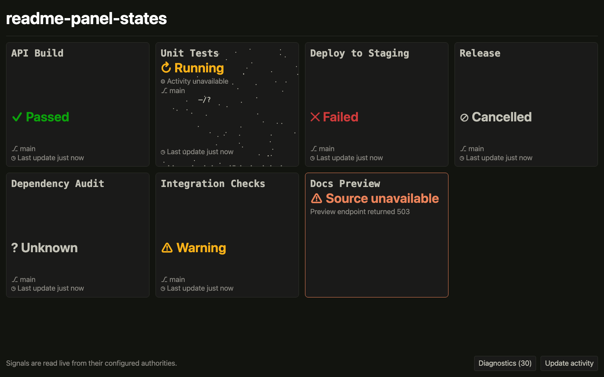
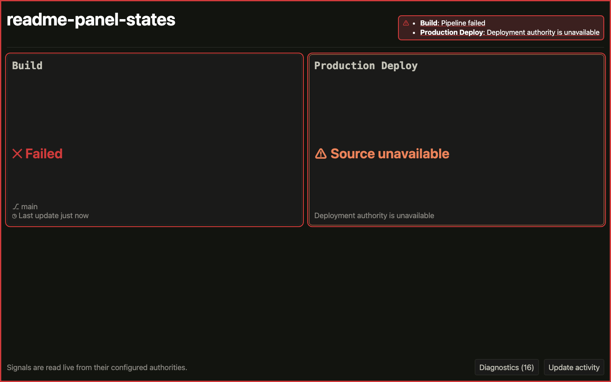
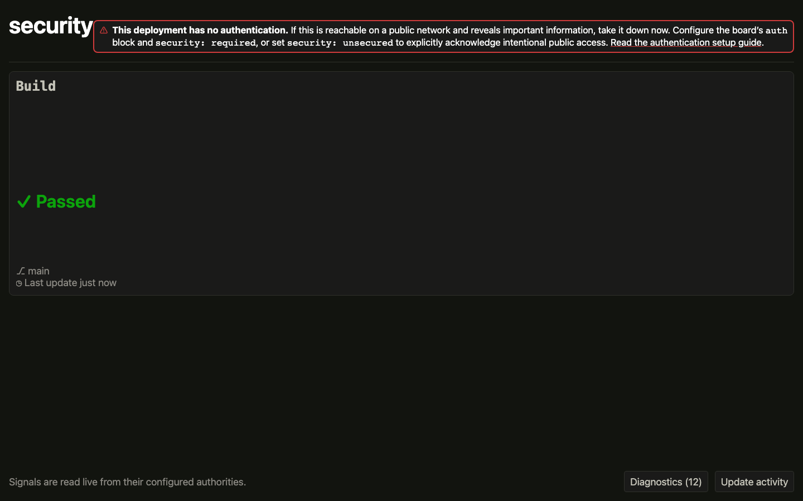
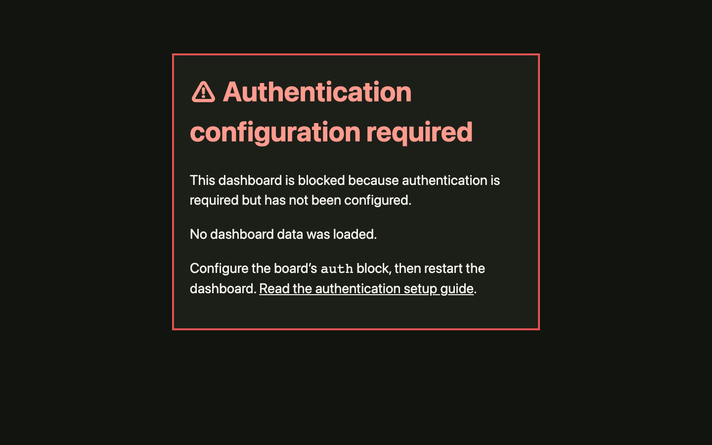
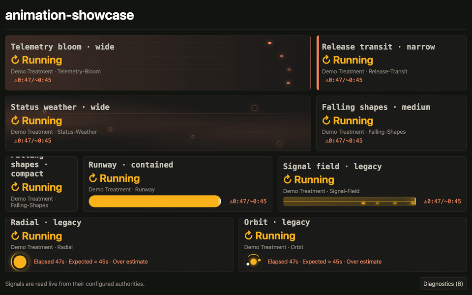

# Feature tour

Ze Great Dashboard presents current engineering signals for quick reading on a laptop or a shared
wall display. Panels identify their source, show when each reading was observed, and link to the
authority behind the status.

## Status at a glance

Pipeline panels support GitHub Actions, GitLab CI, and Azure DevOps Services. HTTP panels can show
scalar text or up to four small JSON-path values. Every state includes a glyph and readable label,
and an unreadable source reports its failure instead of appearing healthy or blank.

## Attention for important signals

Important panels can place urgent failures in an attention rail while preserving the full evidence
in the source panel. Reduced-motion preferences retain the same high-contrast static cue.

## Visible security posture

Deployments that permit unauthenticated access carry a persistent warning.

With `security: required`, unavailable or invalid OIDC configuration blocks the dashboard before it
loads board data. See [OIDC authentication](oidc-authentication.md) for provider setup and policy
options.

## Active pipelines

Running pipelines can use an active treatment while the status label and timing remain readable.
Treatments respect reduced-motion preferences and can be selected per panel.

## Operating cost

In October 2026, one production dashboard in `us-east-1` handled about **545,000 API Gateway
requests**, with **$0.55–$0.69** in estimated charges across the AWS resources examined. The
dashboard ran on Lambda behind an API Gateway HTTP API, stored deployment packages in a dedicated
S3 bucket, and logged to CloudWatch.

| AWS component        | October 2026 cost | How it was measured                                                                                                                                                         |
| -------------------- | ----------------: | --------------------------------------------------------------------------------------------------------------------------------------------------------------------------- |
| API Gateway HTTP API |         $0.545398 | Cost Explorer recorded 545,398 billed HTTP API requests in the region. The dashboard was the only HTTP API found there, and its CloudWatch metric counted 545,400 requests. |
| Lambda               |             $0.00 | Cost Explorer showed zero Lambda charges across the account.                                                                                                                |
| S3 artifact storage  |      Under $0.001 | Estimated from October storage charges and measured bucket size, which averaged 0.025 GiB.                                                                                  |
| S3 requests          |         $0–$0.143 | The upper bound includes all S3 request charges in the account.                                                                                                             |
| CloudWatch           |       $0–$0.00102 | The upper bound includes all CloudWatch charges in the account.                                                                                                             |

The estimate uses October's unblended AWS charges and excludes external services, CI, and
engineering time. [See the billing and attribution details.](https://github.com/robertfmurdock/ze-great-dashboard/issues/75)

Your bill will depend on traffic, Region, account pricing, and free-tier treatment. If you deploy
on ECS with an always-on task, you pay for compute even when nobody is viewing the dashboard.

## Next steps

- [Try the dashboard](../README.md#quick-start).
- [Configure a board](board-configuration.md).
- [Deploy on AWS](aws-setup.md).
